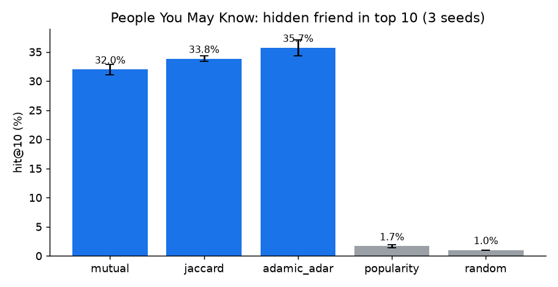
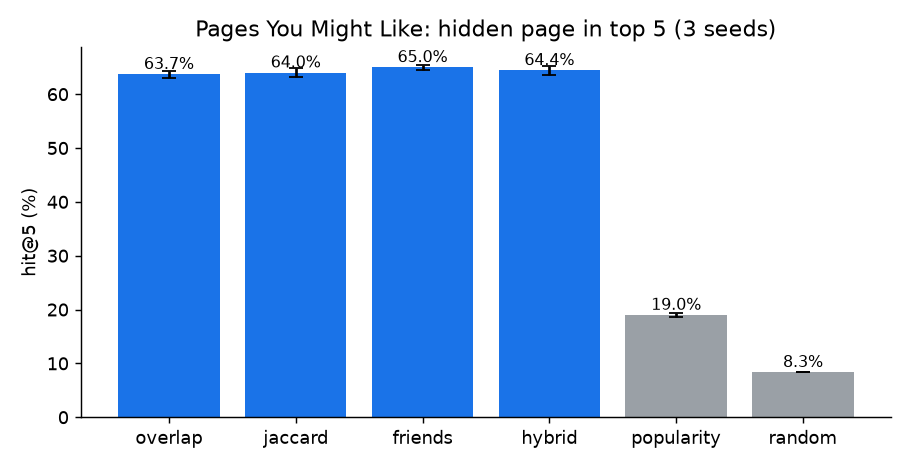

# CodeBook: Social-Network Data Cleaning and Recommendations in Pure Python

"People You May Know" and "Pages You Might Like" for **CodeBook**, a social network for coders, written with **only the Python standard library** (no pandas, NumPy or ML libraries). The project cleans a messy user dump, recommends friends with link-prediction scores and pages with collaborative filtering, and **measures how good the recommendations are** with an offline hold-out evaluation over 3 random seeds.

Project 1 ("Coders of Delhi") of *The Ultimate Job-Ready Data Science Course* (CodeWithHarry). I extended it with more cleaning rules, four extra scoring methods, a synthetic 1,000-user network, an offline evaluation and unit tests.

## Results

| | Result |
|---|---|
| Friend recommendation | **Adamic–Adar** ranks the hidden friend in the top 10 for **35.7%** of held-out friendships, **36× random (1.0%)** and **+12% relative** over plain mutual-friend counting (32.0%) |
| Page recommendation | Collaborative filtering puts the hidden page in the top 5 for **~65%** of users, **7.8× random (8.3%)** and **3.4× most-popular (19.0%)** |
| Data cleaning | **~390 data-quality issues** fixed per 1,000-user dump with 10% corrupted records, and **0 integrity violations** left afterwards (3/3 seeds) |
| Speed | **0.4 ms per user** for both recommenders at 1,000 users, and 3.6 ms per user at 10,000 users |

<p align="center"> </p>

Full tables (Hit@1/5/10 and MRR, mean ± std over 3 seeds): [`results/evaluation.md`](results/evaluation.md).

## How it works

**1. Cleaning** (`codebook/cleaning.py`) returns the cleaned data plus a report of what was fixed:
- drop users with a missing id or blank name, and duplicate user records
- drop duplicate page records
- remove self-friendships, friends that don't exist, duplicate friends, and likes of pages that don't exist
- make friendships symmetric (if A lists B, B lists A)
- drop inactive users (no friends and no likes)

**2. People You May Know** (`codebook/recommend.py`). For user *u* and a non-friend *v*, with N(x) the friends of x:

| Method | Score |
|---|---|
| `mutual` | \|N(u) ∩ N(v)\|, the number of mutual friends |
| `jaccard` | \|N(u) ∩ N(v)\| / \|N(u) ∪ N(v)\| |
| `adamic_adar` | Σ over mutual friends z of 1 / log\|N(z)\|, so a mutual friend with few friends counts more than a celebrity |
| `popularity` | \|N(v)\| (baseline) |

**3. Pages You Might Like** is user-based collaborative filtering. A page liked by user *w* is scored by how similar *w*'s likes are to *u*'s:

| Method | Score of page p |
|---|---|
| `overlap` | Σ over users w who like p of \|L(u) ∩ L(w)\| (shared likes) |
| `jaccard` | the same, normalised by \|L(u) ∪ L(w)\| |
| `friends` | the number of u's friends who like p |
| `hybrid` | jaccard + friend signal |
| `popularity` | total likes (baseline) |

**4. Evaluation** (`scripts/evaluate.py`) uses a synthetic network of 1,000 users in 8 interest communities (`codebook/synthetic.py`). Friendships come from a stochastic block model with triadic closure, and likes follow Zipf-like page popularity plus social influence.
- 10% of friendships are hidden, and we check where the hidden friend ranks.
- One liked page per user is hidden, and we check where it ranks.
- Metrics are Hit@k (is it in the top k?) and MRR (mean of 1/rank), compared against random and most-popular baselines.

## Run it

```bash
python main.py                      # clean data/codebook_data.json and print suggestions for every user
python main.py --user 1 --people-method adamic_adar --page-method hybrid
python -m unittest discover -s tests -v
python scripts/evaluate.py          # about 1 minute -> results/evaluation.md
pip install matplotlib && python scripts/plot_results.py
```

Example output:
```
Cleaning report: users_missing_id_or_name=1, duplicate_user_ids=1, duplicate_page_ids=1, duplicate_friend_entries=1,
self_friendships=1, unknown_page_ids=1, unknown_friend_ids=1, one_sided_friendships_fixed=1, inactive_users_removed=1
Manas (id 1)
  People you may know: Isha, Karan, Arjun
  Pages you might like: Data Science Enthusiasts, Web Dev Hub, DSA & Competitive Programming
```

## Files

| File | Purpose |
|---|---|
| `codebook/cleaning.py` | Cleaning rules and report |
| `codebook/recommend.py` | Friend and page scoring methods |
| `codebook/synthetic.py` | Synthetic network generator (communities, triadic closure, dirty records) |
| `main.py` | Command-line demo |
| `scripts/evaluate.py` | Hold-out evaluation, cleaning integrity check and timing |
| `tests/test_codebook.py` | Unit tests |

## Limitations
- The evaluation uses a synthetic network, so absolute numbers depend on the generator. The ranking of methods against the baselines is the meaningful part.
- Scores are recomputed per user. For millions of users you would precompute friend-of-friend counts or use sparse matrices.

---
[← Back to the course overview and certificate](../README.md) · Manas Jagtap, IIT Bombay
