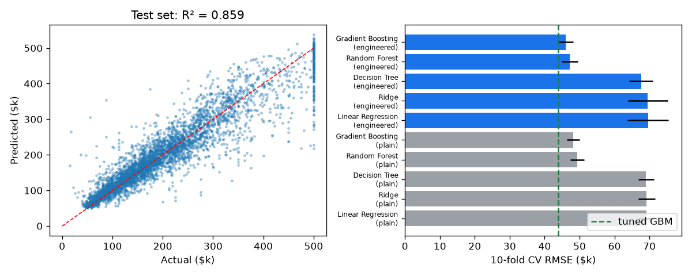
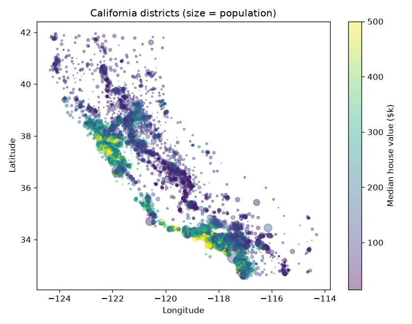
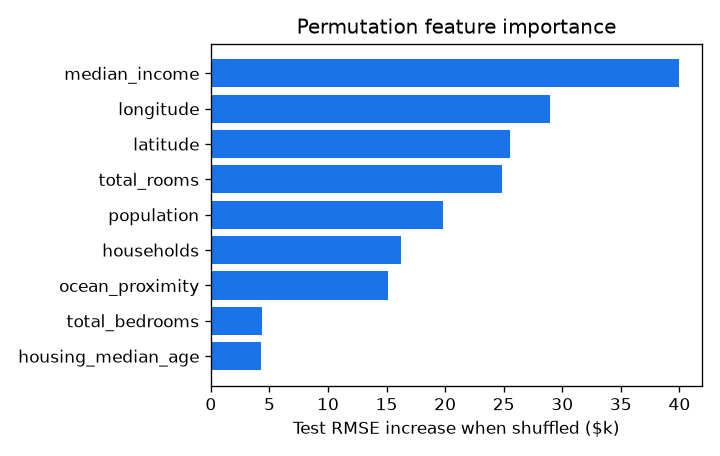

# California Housing Price Prediction

An end-to-end machine-learning pipeline that predicts the **median house value** of a California district from 1990 census data (20,640 districts). It covers stratified sampling, EDA, scikit-learn preprocessing pipelines with **custom transformers**, a comparison of six models with **10-fold cross-validation**, randomised hyper-parameter search, and a final test-set evaluation with a **95% confidence interval**. The trained pipeline is saved for reuse on new data.

Machine-learning project of *The Ultimate Job-Ready Data Science Course* (CodeWithHarry). I extended it with engineered ratio features, geographic cluster-similarity features, gradient boosting, hyper-parameter tuning, confidence intervals and permutation importance.

## Results (held-out test set, 4,128 districts, touched once)

| | Tuned gradient boosting | Linear regression baseline | Predict-the-mean baseline |
|---|---|---|---|
| **RMSE** | **$42,935** (95% CI $41.0k–$44.7k) | $67,347 | $114,165 |
| **R²** | **0.859** | 0.652 | 0 |
| MAE | $28,569 | | |
| Median absolute % error | **10.8%** | | |
| Predictions within ±20% | **74.7%** | | |

- **36% lower RMSE than linear regression** and 62% lower than the mean baseline. R² rises from 0.65 to **0.86**.
- **Feature engineering** (ratios, log transforms and geo clusters) cut gradient-boosting CV RMSE from $48.1k to $46.0k (−4.4%). **Tuning** cut it further to $43.8k (−4.7%).
- The stratified split keeps every income band's share within **0.4%** of the full dataset.

<p align="center"></p>

### Model comparison: 10-fold cross-validated RMSE on the training set

| Model | Plain features | Engineered features |
|---|---|---|
| Predict the mean | $115,700 ± 1,744 | $115,700 ± 1,744 |
| Linear regression | $69,204 ± 2,372 | $69,607 ± 5,849 |
| Ridge | $69,206 ± 2,361 | $69,558 ± 5,708 |
| Decision tree | $69,073 ± 2,293 | $67,649 ± 3,391 |
| Random forest (150 trees) | $49,332 ± 2,040 | $47,247 ± 2,329 |
| Gradient boosting | $48,129 ± 1,811 | $46,027 ± 2,142 |
| **Gradient boosting, tuned** (30-candidate randomised search, 5-fold) | | **$43,849** |

The linear models don't benefit from the engineered features. The relationship with location is highly non-linear, and the tree ensembles exploit the new features far better.

### What drives the price

<p align="center"> </p>

Permutation importance measures how much test RMSE rises when one input column is shuffled:
- **median income** is the strongest single input (+$39.9k)
- **location** (longitude/latitude) comes next (+$29.0k and +$25.6k)

The map shows why: coastal Bay Area and Los Angeles districts are far more expensive.

## Pipeline

1. **Stratified split.** `StratifiedShuffleSplit` on 5 income bands, 80/20, seed 42.
2. **Preprocessing** (`src/features.py`) uses one `ColumnTransformer`, so the identical steps run at training and inference time:
   - median imputation (207 missing `total_bedrooms`)
   - **ratio features** `bedrooms_per_room`, `rooms_per_household`, `people_per_household` (custom `Ratio` transformer)
   - `log1p` and standardisation on the skewed count columns
   - **`ClusterSimilarity`**, a custom transformer: KMeans on (lat, lon), then RBF similarity to each cluster centre (26 clusters after tuning)
   - one-hot encoding of `ocean_proximity`
3. **Models.** Mean baseline, linear, ridge, decision tree, random forest and histogram gradient boosting, compared with 10-fold CV RMSE.
4. **Tuning.** `RandomizedSearchCV` (30 candidates) over learning rate, iterations, leaf count, minimum leaf size, L2 penalty and the number of geo clusters.
   - Best setting: learning rate 0.038, 658 iterations, 38 leaves, 26 clusters.
5. **Test evaluation.** RMSE with a t-based 95% confidence interval on squared errors, plus MAE, R² and % error.
6. **Persistence.** The full pipeline is saved to `models/housing_model.joblib` (0.8 MB), and `src/predict.py` scores new districts.

## Run it

```bash
pip install -r requirements.txt
python src/train.py            # full run, about 10 minutes on a laptop CPU (--quick for about 40 s)
python src/predict.py data/input.csv -o predictions.csv
```

```
 longitude  latitude  median_income ocean_proximity  predicted_median_house_value
   -122.25     37.85            6.5        NEAR BAY                      350400.0
   -119.80     36.75            3.4          INLAND                       83900.0
```

## Limitations
- The data is from the 1990 census, so absolute prices are not current. The point is the method.
- **965 districts are capped at $500,001.** The model can't predict above the cap, which shows as the vertical band at the right of the scatter plot. Removing or modelling the capped rows would be the next step.
- The model works at district level (block groups), not for individual houses.

## Files

| File | Purpose |
|---|---|
| `src/features.py` | Preprocessing pipeline and custom transformers (`Ratio`, `ClusterSimilarity`) |
| `src/train.py` | Split, EDA, model comparison, tuning, test evaluation and plots |
| `src/predict.py` | Inference on new districts with the saved pipeline |
| `results/metrics.json` | Every number in this README |
| `data/housing.csv` | California Housing dataset (Pace & Barry, 1997, from the 1990 US census) |

---
[← Back to the course overview and certificate](../README.md) · Manas Jagtap, IIT Bombay
