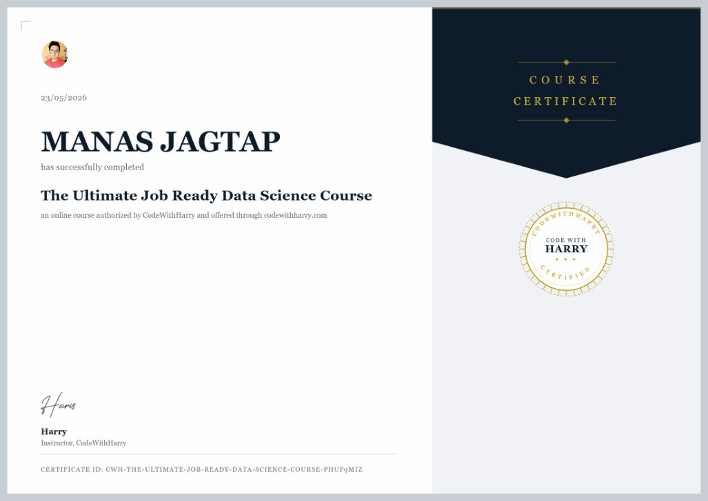

# The Ultimate Job-Ready Data Science Course: My Projects and Notes

I completed **[The Ultimate Job-Ready Data Science Course](https://www.codewithharry.com/courses/the-ultimate-job-ready-data-science-course)** by CodeWithHarry in **May 2026**. It has 24 sections and 203 lectures (33.5 hours), running from Python and statistics to machine learning, deep learning and LLMs.

This repo holds the course projects I built. I extended each one with an evaluation, so they report measured results rather than just running. It also has my notes on what I learned.

<p align="center"></p>
<p align="center"><sub>Certificate ID: CWH-THE-ULTIMATE-JOB-READY-DATA-SCIENCE-COURSE-PHUF9MIZ</sub></p>

## Projects

| # | Project | What I built | Key result |
|---|---|---|---|
| 1 | [**Coders of Delhi**: social-network recommender](01-coders-of-delhi) | Data cleaning plus "People You May Know" and "Pages You Might Like" for a coders' social network, in **pure Python** (no libraries). I added link-prediction scores (Jaccard, Adamic–Adar), collaborative filtering and an offline hold-out evaluation | Hidden friend in the top 10 **36× more often than random**; hidden page in the top 5 for **65%** of users (7.8× random). **0** integrity errors left after cleaning |
| 2 | [**California Housing** price prediction](02-california-housing) | End-to-end **scikit-learn** pipeline: stratified split, custom transformers (ratio and geo-cluster features), 6 models compared with 10-fold CV, randomised search, and a test set used once | Test **R² 0.86**, RMSE **$42.9k** (95% CI $41.0k–$44.7k), **36% lower** than linear regression |
| 3 | **RAG AI teaching assistant** | Course videos → mp3 → **Whisper** transcripts with timestamps → chunks → embeddings → top matching chunks → **LLM** answer that names the video and timestamp | *Being rebuilt; added soon* |

## What I learned

| Course section | What I can now do | Notes |
|---|---|---|
| Python refresher, conda | Write clean, data-oriented Python (comprehensions, sets, dicts, JSON) and manage environments | [notes](notes/01_python_numpy_pandas.md) |
| Projects 1 and 2 (pure Python) | Clean messy nested data and build recommendation logic without libraries | [project 1](01-coders-of-delhi) |
| NumPy | Vectorised computation, broadcasting, axes, boolean masks, views vs copies | [notes](notes/01_python_numpy_pandas.md) |
| Pandas | Load, explore, clean, group, merge and reshape tabular data | [notes](notes/01_python_numpy_pandas.md) |
| Matplotlib and Seaborn | Choose the right chart and show uncertainty | [notes](notes/02_visualisation.md) |
| Data collection | Files, APIs and web scraping | [notes](notes/03_data_collection_sql.md) |
| SQL for data science | Joins, GROUP BY / HAVING, sub-queries, CTEs and window functions | [notes](notes/03_data_collection_sql.md) |
| Probability, distributions, CLT | Bayes' rule, common distributions, and the CLT **verified numerically** | [notes](notes/04_probability_statistics.md) |
| Machine learning and scikit-learn | The full workflow: split, pipelines, cross-validation, tuning and evaluation | [notes](notes/05_machine_learning.md), [project 2](02-california-housing) |
| Deep learning | Neural networks, backpropagation, optimisers and regularisation | [notes](notes/06_deep_learning.md) |
| Web development for data scientists | Serve a model with Flask | [notes](notes/07_flask_llms_rag.md) |
| LLMs, using AI as a data scientist | Prompting, embeddings and RAG | [notes](notes/07_flask_llms_rag.md) |
| Git, Google Colab | Version control and GitHub workflow; GPU notebooks | [notes](notes/08_git_tools.md) |

**Central Limit Theorem check** ([`notes/clt_demo.py`](notes/clt_demo.py)): with 20,000 sample means drawn from a skewed exponential distribution, the skewness falls exactly as the theory's 2/√n predicts (2.01 → 0.20 from n = 1 to n = 100). The spread matches σ/√n to within 0.6%.

## Run the projects

```bash
# Project 1: pure Python, nothing to install
cd 01-coders-of-delhi
python main.py --user 1
python -m unittest discover -s tests
python scripts/evaluate.py

# Project 2
cd ../02-california-housing
pip install -r requirements.txt
python src/train.py --quick
python src/predict.py data/input.csv
```

---
Manas Jagtap · Dual Degree, Electrical Engineering, IIT Bombay · [GitHub profile](https://github.com/ManasJ-2007)
