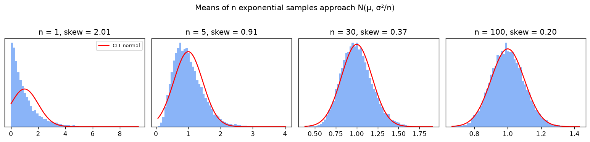

# Probability, distributions and the Central Limit Theorem

## Core rules
- Conditional probability: P(A | B) = P(A ∩ B) / P(B). **Bayes:** P(A | B) = P(B | A) P(A) / P(B).
- Independence: P(A ∩ B) = P(A) P(B).
- Expectation is linear: E[aX + bY] = aE[X] + bE[Y]. Var[X] = E[X²] − E[X]², and Var[aX] = a² Var[X].

**Bayes example (base-rate trap).** A test is 99% sensitive and 95% specific for a condition with 1% prevalence. Then P(sick | positive) = 0.99·0.01 / (0.99·0.01 + 0.05·0.99) = **16.7%**. Most positives are false, because the condition is rare.

## Distributions
| Distribution | Models | Mean | Variance |
|---|---|---|---|
| Bernoulli(p) | one yes/no trial | p | p(1−p) |
| Binomial(n, p) | number of successes in n trials | np | np(1−p) |
| Poisson(λ) | count of rare events in an interval | λ | λ |
| Uniform(a, b) | anything equally likely in [a, b] | (a+b)/2 | (b−a)²/12 |
| Normal(μ, σ²) | sums of many small effects | μ | σ² |
| Exponential(λ) | waiting time between Poisson events | 1/λ | 1/λ² |

Normal rule of thumb: about 68% / 95% / 99.7% of values fall within 1 / 2 / 3 σ of the mean.

## Central Limit Theorem
For i.i.d. samples with mean μ and finite variance σ², the sample mean satisfies (X̄ − μ) / (σ/√n) → N(0, 1) **whatever the original distribution**. The standard error σ/√n shrinks like 1/√n, so 4× more data halves the error.

**Checked numerically** (`clt_demo.py`, 20,000 sample means per n, drawn from a heavily skewed exponential distribution):

| n | Skewness of the sample mean (theory 2/√n) | Measured std / theory σ/√n |
|---|---|---|
| 1 | 2.01 (2.00) | 0.994 |
| 5 | 0.91 (0.89) | 1.005 |
| 30 | 0.37 (0.37) | 1.005 |
| 100 | 0.20 (0.20) | 0.999 |

Skewness falls towards 0 (normal) at exactly the predicted rate 2/√n. The spread matches σ/√n to within **0.6%**.

## Where it shows up
- **Confidence intervals:** project 2's test RMSE comes with a t-based 95% CI on the mean squared error, which relies on the CLT.
- Cross-validation means ± std, A/B tests, and why averaging over seeds makes results trustworthy.
